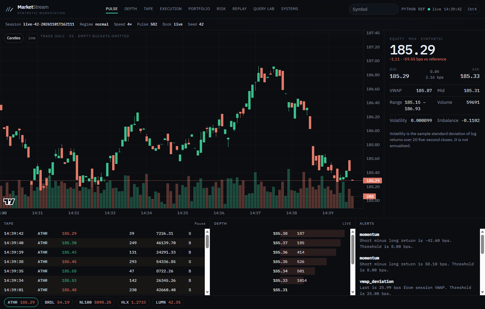
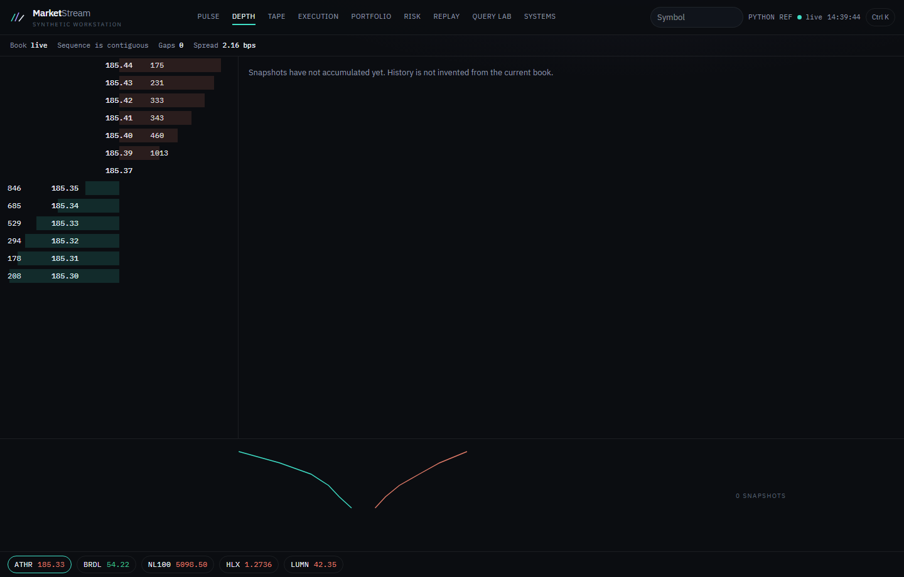
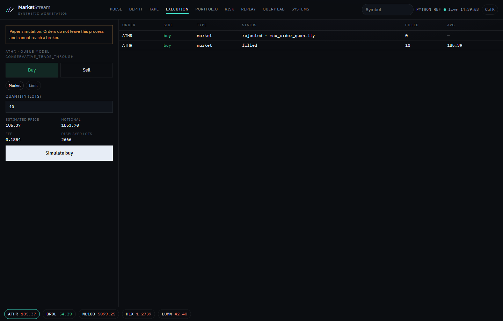
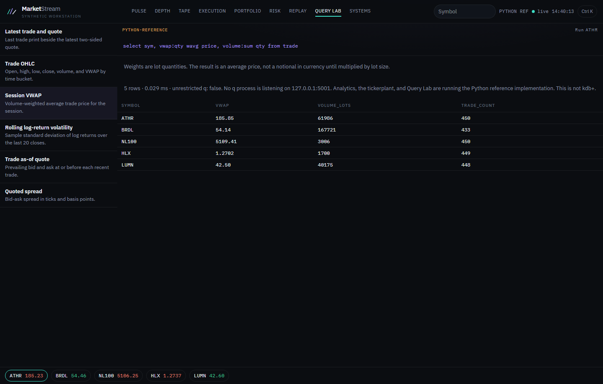

# MarketStream

MarketStream is a simulated trading workstation. It turns a deterministic stream of synthetic trades, quotes, and order-book updates into a reconstructable book, a paper account, and a set of risk and analytics views.

Nothing in the default process is a live exchange feed, and nothing in the order ticket is a real order. The instruments are fictional: Aether Semiconductor (`ATHR`), Broadleaf (`BRDL`), Northline 100 (`NL100`), Helix FX (`HLX`), and Lumen Coin (`LUMN`).

## What is actually running

On this machine there is no kdb+ / KDB-X runtime. KDB-X Community Edition needs a licence key from the KX Developer Center and, on Windows, a WSL2 Linux distro. Native Windows is not a supported KDB-X platform.

Until that runtime is installed and listening, MarketStream runs in **Python reference mode**:

- The simulator, feedhandler, order book, paper fills, positions, risk checks, and REST/WebSocket API are real and tested.
- The q scripts under `q/` are real source, including `q/tests/runtests.q`. They have **not** been executed here, because `q` is not on `PATH`.
- The ribbon and Systems workspace say `PYTHON REF`. Query Lab shows the q expression and the Python result, and it records `executed_unrestricted_q: false`. The Python result is not a kdb+ result.

If a q process is later started on `127.0.0.1:5001` with the project scripts loaded, the bridge attempts an unlicensed PyKX IPC connection. Embedded q inside Python still requires a licence. See [docs/KDB_ENGINE.md](docs/KDB_ENGINE.md).

## Architecture

```
simulator → feedhandler → session log
                       ↘ in-memory book, trades, quotes
                       ↘ optional q IPC
paper orders → reconstructed book → fills → weighted-average positions
WebSocket / REST → React workstation
```

The live account ledger is append-only JSONL. Replay uses a separate book and does not write that ledger.

Details: [docs/ARCHITECTURE.md](docs/ARCHITECTURE.md).

## Run it

Requirements: Python 3.12, Node 22. Docker is optional. q is optional.

```powershell
python -m venv .venv
.\.venv\Scripts\python -m pip install -e ".\backend[dev]"
.\.venv\Scripts\python -m marketstream
```

In another terminal:

```powershell
cd frontend
npm install
npm run dev
```

Open http://127.0.0.1:5173. The API listens on http://127.0.0.1:8000. If that port is already taken, set `MARKETSTREAM_PORT` and start Vite with the same target:

```powershell
$env:MARKETSTREAM_PORT="8765"
$env:MARKETSTREAM_API="http://127.0.0.1:8765"
```

Copy `.env.example` to `.env` to change the seed, speed, or q port. Do not put a licence key in git.

`scripts/dev.ps1` starts both. The first launch writes six demo sessions into `data/sessions/` (about six seconds on the machine used for development) and warms the live book before serving.

## Walkthrough

The steps in [docs/DEMO_GUIDE.md](docs/DEMO_GUIDE.md) are the ones the UI and API actually implement: live book, paper order, positions, risk, a regime shock, replay, an allowlisted query, and measured feed counters.

## Workstation

These frames are from a local Python-reference session. The ribbon says `PYTHON REF` because no q process was listening.









## Tests

```powershell
.\.venv\Scripts\python -m pytest backend\tests -q
cd frontend
npm run build
npm run test:e2e
```

Domain tests check VWAP, OHLC, book gaps, deterministic seeds, market-order walks, the trade-through rule, weighted-average P&L, cash reconciliation, and limit rejects. They assert numbers, not just that a field exists.

q tests, when a runtime exists:

```bash
cd q
q tests/runtests.q
```

## Benchmarks

Measured with `benchmarks/run_benchmark.py` on an Intel i7-9750H, 32 GB RAM, Python 3.12, single process. These are in-process rates, not exchange latencies. kdb+ was not timed, because it is not installed.

| events | generate evt/s | feed evt/s | book apply evt/s |
| ---: | ---: | ---: | ---: |
| 10,000 | 16,439 | 31,046 | 104,525 |
| 100,000 | 22,197 | 26,146 | 112,555 |

A one-million-event run was not part of this measurement pass. See [docs/PERFORMANCE.md](docs/PERFORMANCE.md).

## Design

There is no left navigation sidebar. Workspaces sit in the top ribbon: Pulse, Depth, Tape, Execution, Portfolio, Risk, Replay, Query Lab, Systems. `Ctrl+K` opens the command palette. Number keys `1`–`9` switch workspaces when focus is not in a field.

The visual system is documented in [docs/UI_DESIGN_SYSTEM.md](docs/UI_DESIGN_SYSTEM.md).

## Further reading

- [Market-data model](docs/MARKET_DATA_MODEL.md)
- [Order book](docs/ORDER_BOOK.md)
- [Paper execution](docs/EXECUTION_SIMULATION.md)
- [P&L](docs/PNL_ACCOUNTING.md)
- [Risk](docs/RISK_MODELS.md)
- [Replay](docs/REPLAY_ENGINE.md)

## Licence

Project code is MIT. The KDB-X runtime is not included and remains under KX terms.
